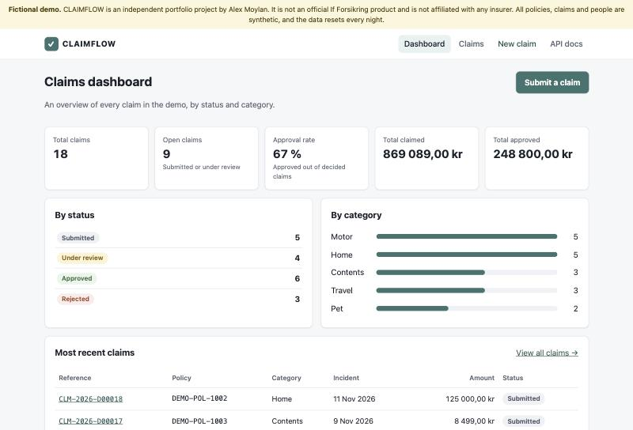
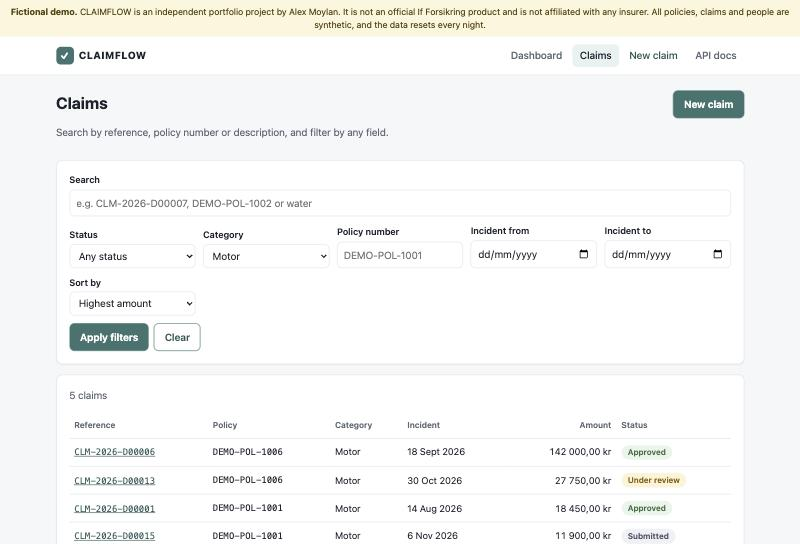
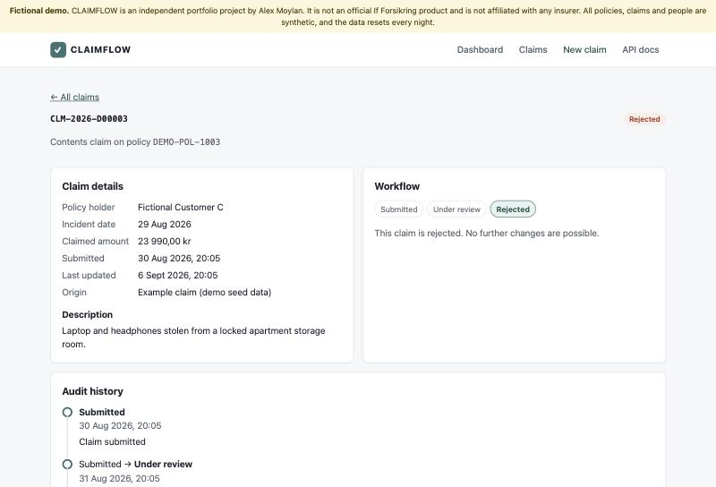
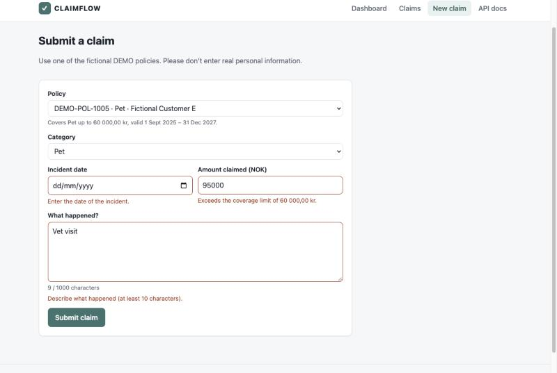
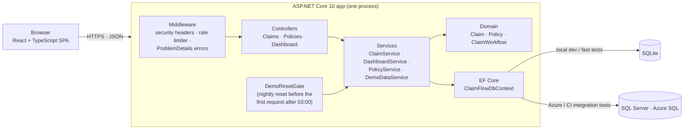
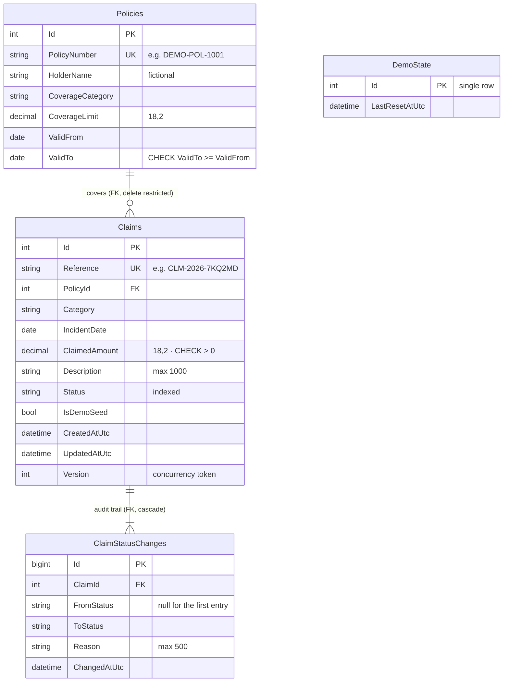
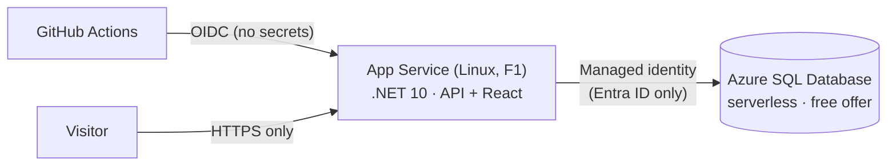

# CLAIMFLOW: Insurance Claims Management

A full-stack insurance claims demo built with **C# / ASP.NET Core 10**, **EF Core**, **SQL Server / SQLite**
and **React + TypeScript**. Claims move through an enforced workflow (Submitted → Under Review →
Approved / Rejected), and every status change is recorded in an audit history.

> **Independent, fictional portfolio project.** CLAIMFLOW was built by Alex Moylan as a portfolio piece.
> It is **not** an official If Forsikring product and is not affiliated with any insurer. Every policy, claim,
> name and amount is synthetic. Please don't enter real personal information into the demo.

**Live demo:** not deployed yet. Azure deployment is planned (see [Azure architecture](#azure-architecture)).



## Contents

- [Features](#features)
- [Architecture](#architecture)
- [Tech stack](#tech-stack)
- [Run it locally](#run-it-locally)
- [API](#api)
- [Database design](#database-design)
- [Testing](#testing)
- [CI/CD](#cicd)
- [Azure architecture](#azure-architecture)
- [Security and demo safety](#security-and-demo-safety)
- [Known limitations](#known-limitations)
- [Development note](#development-note)

## Features

- **Dashboard:** total, open and decided claims, approval rate, claimed and approved amounts, counts by
  status and category, and the most recent claims.
- **Claims list:** search by reference, policy number or description, and filter by status, category,
  policy and incident date range. Results can be sorted and paged, and every filter lives in the URL, so a
  view can be bookmarked.
- **Claim detail:** policy, amounts and description, the workflow actions available *right now*, and the
  full audit history.
- **New claim:** a form backed by a fictional policy dataset. Client-side checks mirror the server's rules,
  and anything the server rejects is shown next to the matching field.
- **Workflow enforced on the server:** invalid transitions return `409 Conflict`, and a rejection must
  include a reason.
- **Business rules:** the policy must exist, the category must match the policy's coverage, the incident
  must fall inside the policy period and not in the future, and the amount must be within the coverage
  limit with at most two decimal places.

| Claims list                                | Claim detail and audit history               | Validation                                                   |
| ------------------------------------------ | -------------------------------------------- | ------------------------------------------------------------ |
|  |  |  |

## Architecture

The app ships as one deployable. The ASP.NET Core app serves both the JSON API and the built React files,
so the browser only ever talks to one origin. That means no CORS configuration and a single App Service.



**Why it is laid out this way.** It is a single API project with clear folders, not a multi-project
"clean architecture". That is deliberate: the app is small, and the folders already separate the concerns.

| Folder (`src/ClaimFlow.Api`) | Responsibility                                                                                                                                                         |
| ---------------------------- | ---------------------------------------------------------------------------------------------------------------------------------------------------------------------- |
| `Domain/`                    | Entities and rules with no framework code. `ClaimWorkflow` is the single source of truth for allowed transitions, and `Claim.TransitionTo` is the only way to change a status. |
| `Services/`                  | Use cases: search, create, transition, dashboard and demo reset. This is where policy rules are checked.                                                              |
| `Controllers/`               | Thin HTTP adapters. They bind and validate input, call a service and return the result.                                                                               |
| `Contracts/`                 | Request and response DTOs. Entities are never serialised directly.                                                                                                    |
| `Data/`                      | `ClaimFlowDbContext`, provider registration, seed data and the two migration sets.                                                                                    |
| `Infrastructure/`            | Cross-cutting concerns: the exception → ProblemDetails mapping, rate limiting and security headers.                                                                   |

Errors are domain exceptions (`NotFoundException`, `DomainValidationException`,
`InvalidStatusTransitionException`, `DemoLimitReachedException`), each mapped to one HTTP status in
`ProblemDetailsExceptionHandler`. Controllers never build error responses by hand.

## Tech stack

| Area     | Choice                                                                                                                         |
| -------- | ------------------------------------------------------------------------------------------------------------------------------ |
| Backend  | C# 14, .NET 10 LTS, ASP.NET Core Web API (controllers), EF Core 10                                                             |
| Database | SQLite (local development and fast tests) and SQL Server / Azure SQL (production and CI integration tests)                    |
| API docs | Built-in `Microsoft.AspNetCore.OpenApi` (OpenAPI 3.1) and a [Scalar](https://scalar.com) reference UI                          |
| Frontend | React 19, TypeScript 5.9, Vite 8, React Router 7, TanStack Query 5, plain CSS                                                  |
| Tests    | xUnit v3 on Microsoft Testing Platform, `WebApplicationFactory`, Testcontainers (SQL Server), Vitest and Testing Library        |
| Infra    | Azure App Service (Linux), Azure SQL Database (free offer), Bicep, GitHub Actions with OIDC                                     |

## Run it locally

**Prerequisites:** [.NET SDK 10.0.404+](https://dotnet.microsoft.com/download/dotnet/10.0) and Node.js 22.12 or
later. You don't need Docker or a database server: local development uses SQLite.

```bash
git clone https://github.com/Ajmoylan/claimflow.git
cd claimflow
```

Start the API on http://localhost:5080. It creates `claimflow.dev.db` and seeds the demo data on first run.

```bash
dotnet run --project src/ClaimFlow.Api --launch-profile http
```

In a second terminal, start the frontend on http://localhost:5173. It proxies `/api` to the API.

```bash
cd web && npm install && npm run dev
```

Then open:

- http://localhost:5173 for the app
- http://localhost:5080/docs for the API reference (Scalar)
- http://localhost:5080/openapi/v1.json for the OpenAPI document
- http://localhost:5080/health for the health check

To start again from the original example data, stop the API and delete
`src/ClaimFlow.Api/claimflow.dev.db*`.

### Debugging

- **VS Code:** `.vscode/launch.json` has a **CLAIMFLOW API (SQLite)** configuration (breakpoints in C#) and a
  **CLAIMFLOW web (Chrome)** configuration (breakpoints in the TypeScript source). Start the Vite dev server
  first for the second one.
- **Visual Studio / Rider:** open `ClaimFlow.slnx` and run the `http` launch profile.
- **SQL:** in Development, EF Core logs every SQL command (`Microsoft.EntityFrameworkCore.Database.Command`)
  to the console. Inspect the local database with `sqlite3 src/ClaimFlow.Api/claimflow.dev.db`.
- **Errors:** every error response includes a `traceId` that matches the server log entry for that request.
- **Tests:** run a single test with `dotnet test --filter-method "*Transition_FullWorkflow*"`, or debug tests
  from the IDE's test explorer.

### Configuration

| Setting                                 | Default                             | Purpose                                                     |
| --------------------------------------- | ----------------------------------- | ----------------------------------------------------------- |
| `Database:Provider`                     | `Sqlite`                            | `Sqlite` or `SqlServer`                                     |
| `ConnectionStrings:ClaimFlow`           | `Data Source=claimflow.dev.db`      | Database connection                                         |
| `Database:MigrateOnStartup`             | `true`                              | Apply EF Core migrations at startup                         |
| `Demo:MaxVisitorClaims`                 | `200`                               | Cap on visitor-created claims between resets                |
| `Demo:ResetTimeOfDay` / `ResetTimeZone` | `03:00` / `Europe/Oslo`             | Nightly demo reset schedule                                 |
| `RateLimiting:*`                        | 120 requests/min, 10 writes/min per client, 60 writes/min in total | Request limits for the public demo |

## API

Interactive documentation is served at `/docs`, and the OpenAPI 3.1 document at `/openapi/v1.json`.

| Method | Path                                    | Description                                                                                                       | Success | Errors             |
| ------ | --------------------------------------- | ----------------------------------------------------------------------------------------------------------------- | ------- | ------------------ |
| GET    | `/api/claims`                           | Search and filter: `search`, `status`, `category`, `policyNumber`, `incidentFrom`, `incidentTo`, `sort`, `page`, `pageSize` (≤ 100) | 200     | 400                |
| GET    | `/api/claims/{reference}`               | Claim detail with audit history and `allowedNextStatuses`                                                         | 200     | 404                |
| GET    | `/api/claims/{reference}/history`       | Audit history only, oldest first                                                                                  | 200     | 404                |
| POST   | `/api/claims`                           | Submit a claim                                                                                                    | 201 + `Location` | 400, 413, 415, 429 |
| POST   | `/api/claims/{reference}/transitions`   | `{ "targetStatus": "UnderReview" \| "Approved" \| "Rejected", "reason": "…" }`                                     | 200     | 400, 404, 409, 429 |
| GET    | `/api/policies`                         | The fictional policies, read-only                                                                                 | 200     |                    |
| GET    | `/api/dashboard/summary`                | Dashboard figures and demo status                                                                                 | 200     |                    |
| GET    | `/health`                               | Health check (includes database connectivity)                                                                     | 200     | 503                |

Every error is an [RFC 9457](https://www.rfc-editor.org/rfc/rfc9457) `application/problem+json` response
with a `traceId`. Validation errors also include field-level `errors`:

```json
{
  "title": "One or more validation errors occurred.",
  "status": 400,
  "errors": {
    "IncidentDate": ["Incident date must be within the policy period (2024-01-01 to 2024-12-31)."],
    "Category": ["Policy DEMO-POL-1008 covers Travel claims only."]
  },
  "traceId": "00-…"
}
```

## Database design



- **Relational integrity lives in the database too:** unique business keys, foreign keys, check
  constraints and a cascading audit trail. The integration tests bypass the API to prove that the database
  itself rejects bad data.
- **Optimistic concurrency:** `Version` is incremented on every change. If two people change the same claim
  at once, the second save fails with `409 Conflict` instead of silently overwriting the first.
- **Enums are stored as strings,** so the tables stay readable.
- **All timestamps are UTC.** A value converter marks them as UTC on read, so JSON always carries `Z`.

### Two database providers, managed explicitly

SQLite makes local development and the test suite fast and dependency-free. SQL Server is what runs in
production. Each provider has its own small `DbContext` subclass, with its own migrations folder
(EF Core's documented *multiple context types* approach):

```
src/ClaimFlow.Api/Data/
├── ClaimFlowDbContext.cs          # the shared model (the app only depends on this)
├── ProviderContexts.cs            # SqliteClaimFlowDbContext, SqlServerClaimFlowDbContext
└── Migrations/
    ├── Sqlite/
    └── SqlServer/
```

Add a migration for **both** providers whenever the model changes:

```bash
dotnet tool restore
dotnet ef migrations add <Name> --project src/ClaimFlow.Api --context SqliteClaimFlowDbContext --output-dir Data/Migrations/Sqlite
dotnet ef migrations add <Name> --project src/ClaimFlow.Api --context SqlServerClaimFlowDbContext --output-dir Data/Migrations/SqlServer
```

CI fails if either migration set is missing a model change (`dotnet ef migrations has-pending-model-changes`).

Provider differences that were handled deliberately:

| Topic                         | SQLite                                                                    | SQL Server                     | How CLAIMFLOW handles it                                                                                            |
| ----------------------------- | ------------------------------------------------------------------------- | ------------------------------ | ------------------------------------------------------------------------------------------------------------------- |
| `decimal`                     | Stored as TEXT; EF Core adds functions so sorting and `SUM` work            | `decimal(18,2)`                | Covered by tests on both (sort by amount, dashboard totals)                                                          |
| Dates                         | TEXT (ISO 8601)                                                           | `date` / `datetime2`           | `DateOnly` for incident dates, and UTC `DateTime` with a converter                                                  |
| Row versioning                | No `rowversion` type                                                      | `rowversion` available         | An application-managed `int Version` concurrency token works the same on both                                       |
| Case-insensitive search       | `LIKE` is case-insensitive for ASCII only                                 | Case-insensitive collation     | `EF.Functions.Like` with escaped wildcards; non-ASCII case-folding (æøå) may differ locally                         |
| Transient faults              | n/a                                                                       | Azure SQL can pause and resume | `EnableRetryOnFailure`, plus the demo reset runs inside the execution strategy                                       |

## Testing

```bash
dotnet test                       # 108 tests: 53 unit + 55 integration (1 is SQL Server-only and skipped on SQLite)
cd web && npm test                # 13 frontend tests (Vitest + Testing Library)
```

Run the integration tests against a real SQL Server (needs Docker; this is what CI does on Linux x64):

```bash
CLAIMFLOW_TEST_PROVIDER=SqlServer dotnet test --project tests/ClaimFlow.IntegrationTests
```

| Suite                                  | What it covers                                                                                                                                                                                                                                                         |
| -------------------------------------- | ---------------------------------------------------------------------------------------------------------------------------------------------------------------------------------------------------------------------------------------------------------------------- |
| `ClaimFlow.UnitTests`                  | Every possible status transition (4×4), audit entries and versioning, the reason rule, request validation, reference generation, the nightly-reset schedule including daylight-saving changes, and seed-data consistency.                                                      |
| `ClaimFlow.IntegrationTests`           | The real app in memory (`WebApplicationFactory`) with real migrations: create (201, `Location`, persisted, audit started), retrieval, filtering, search (including literal `%`/`_`), paging, sorting, 400/404/409/413/415/429 ProblemDetails, the full workflow, database constraints, cascades, concurrency conflicts, demo reset and limits, the nightly reset with no background service (simulating a sleeping app), rate limiting, security headers and OpenAPI. |
| `web/src/**/*.test.ts(x)`              | The API client and ProblemDetails parsing, form validation rules, server errors shown on fields, and that the workflow panel offers only allowed actions.                                                                                                             |

Each integration-test class gets its own fresh database (an in-memory SQLite database, or a new database
on the SQL Server container). Each test starts from the seed data. A fake `TimeProvider` makes the date
rules deterministic.

## CI/CD

| Workflow                | Runs on                          | What it does                                                                                                                                                                                                                                  |
| ----------------------- | -------------------------------- | --------------------------------------------------------------------------------------------------------------------------------------------------------------------------------------------------------------------------------------------- |
| `ci.yml`                | push to `main`, pull requests    | `dotnet format` check, a Release build with warnings as errors, a migrations-vs-model check, unit and integration tests on SQLite with coverage, **integration tests on SQL Server 2022 in a container**, vulnerable NuGet package check, frontend format/lint/typecheck/tests/build, `npm audit`, then packages the app as one artifact. On `main`, a final `deploy` job logs in to Azure with GitHub OIDC (no stored secrets), deploys **that same artifact** to App Service and smoke-tests it. **The deploy job does nothing until the Azure repository variables are set.** |
| `codeql.yml`            | push, pull requests, weekly      | CodeQL `security-extended` for C#, TypeScript and the workflows themselves                                                                                                                                                                    |
| `dependency-review.yml` | pull requests                    | Blocks new dependencies with high-severity advisories                                                                                                                                                                                         |

All actions are pinned to full commit SHAs and run with minimal `permissions`. Dependabot keeps NuGet,
npm and Actions dependencies current.

## Azure architecture



Defined in [`infra/main.bicep`](infra/main.bicep). The app runs in **Belgium Central** and the database in
**France Central**: of the regions this subscription may use, France Central is the only one offering the
Azure SQL free tier, and it has no free App Service (F1) quota. Traffic between them costs 0.19 NOK/GB,
well under 1 NOK a month for this demo (details in [`infra/DEPLOYMENT.md`](infra/DEPLOYMENT.md)).

- **No secrets anywhere:** the app authenticates to Azure SQL with its system-assigned managed identity,
  the SQL server only accepts Entra ID logins over TLS 1.2+, its firewall admits only the Web App's own
  outbound addresses, and GitHub deploys through OIDC federation. Basic-auth
  publishing (FTP/SCM) is turned off.
- **Expected cost: under 1 NOK a month** (inter-region transfer only). The App Service F1 plan is free, and the Azure SQL free offer gives
  100 000 vCore-seconds and 32 GB per month, with `freeLimitExhaustionBehavior: AutoPause` so the database
  pauses instead of billing when the allowance runs out.
- **The database can actually pause.** ADO.NET keeps idle pooled connections open for 4–8 minutes, and a
  serverless database only pauses after its auto-pause delay with zero sessions. `IdleSqlConnectionReleaser`
  closes the pool once the app has not touched the database for 2 minutes. Nothing else polls the database:
  no health-check probe, no Always On, and the nightly-reset gate only queries when a reset is due. A CI test
  on SQL Server checks that no sessions remain after the idle period.
- **Migrations** run at startup. That is simple and safe for a single-instance demo. A multi-instance
  production system would apply them in the pipeline instead (for example with an EF Core migration bundle).

After the first deployment, the app's identity is granted database access once with
[`infra/grant-app-db-access.sql`](infra/grant-app-db-access.sql).

The exact deployment procedure, cost breakdown, free-tier limits and teardown are in
[`infra/DEPLOYMENT.md`](infra/DEPLOYMENT.md).

## Security and demo safety

The public demo is anonymous, so it is built to be hard to abuse and impossible to damage permanently:

- **No public reset endpoint.** The data is restored automatically every night at 03:00 Oslo time, and the
  reset does not depend on a long-running background process. The free App Service tier unloads idle apps,
  so the process may simply not be running at 03:00. To cover that, `DemoResetGate` runs before every `/api`
  request and at startup. It keeps the next scheduled reset time in memory, so a normal request costs one
  time comparison. Once that time has passed, the first request runs the reset check while concurrent
  requests wait, so nobody sees or adds to the previous day's data. If the check fails (for example while
  Azure SQL is resuming), the request is still served and the check is retried a minute later. A background
  timer also checks every 15 minutes while the app is awake. That covers quiet nights, but correctness does
  not depend on it, and an integration test proves the reset happens with the background service removed.
- **Bounded writes:** a cap on visitor-created claims (200 by default) returns `429` with an explanation until
  the next reset. On top of that, 10 writes per minute per client and 60 per minute in total, 120 requests
  per minute per client, and a 16 KB request body limit.
- **Read-only reference data:** visitors cannot create, edit or delete policies, and there are no admin or
  privileged endpoints.
- **Validated input** at the API boundary and again by database constraints. Queries are parameterised,
  and search wildcards are escaped.
- **Safe errors:** ProblemDetails without stack traces, SQL or internal type names.
- **Browser hardening:** a strict same-origin Content-Security-Policy, `nosniff`,
  `X-Frame-Options: DENY`, `Referrer-Policy: no-referrer`, and HSTS in production. The API docs page is
  self-contained: no external fonts, telemetry or AI features.
- **Logs without personal data:** structured JSON logs in production record claim references and status
  changes. Client IP addresses are used only as in-memory rate-limit keys.

See [SECURITY.md](SECURITY.md) to report a vulnerability.

## Known limitations

- **Cold starts:** on the free tier the app sleeps when idle, and the serverless database pauses. The first
  request after a quiet period can take up to about a minute. The UI shows a loading state and retries server
  errors automatically (up to twice).
- **Free-tier CPU quota:** App Service F1 allows 60 CPU minutes per day. Sustained abuse could exhaust it and
  stop the app until the quota resets. The rate limits make this unlikely, but they cannot rule it out.
- **Rate limits are per instance and in memory,** which is right for a single instance. Scaling out would
  need a distributed limiter or a gateway such as Azure Front Door.
- **The visitor-claim cap** is checked before each insert, so two exactly simultaneous requests at the
  limit could exceed it by one or two. That is acceptable for a demo.
- **No authentication or roles:** anyone can move any claim through the workflow. A real system would add
  Entra ID sign-in with claim-handler and approver roles, and record *who* made each change.
- **Development-only `npm audit` advisory:** at the time of writing there is no patched version of
  `picomatch` (used only by the Vite/Vitest build tooling, never shipped to the browser). CI blocks
  runtime-dependency advisories and reports development ones.

## Development note

This project was developed using AI-assisted coding tools. Its functionality is supported by automated
tests and reproducible security scans.

## License

[MIT](LICENSE)
